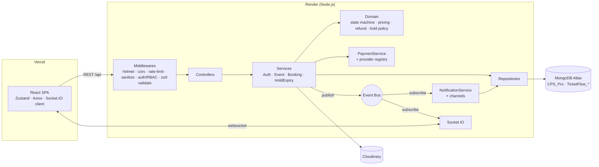
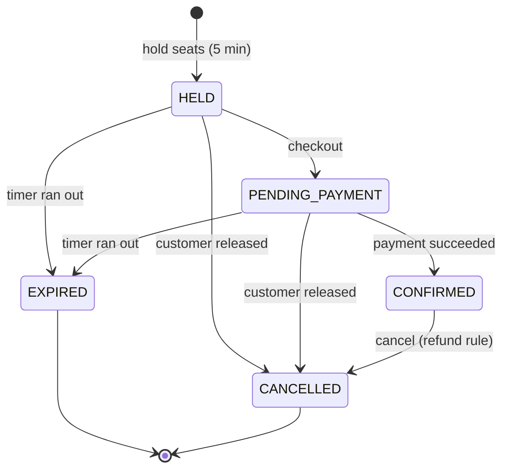

# TicketFlow Architecture

## 1. Big picture



Two tiers, as required: the **client** (React, Vercel) and the **server** (Express, Render) talking to **MongoDB Atlas**. All data lives in database `CPS_Pro`, in collections prefixed `TicketFlow_` (`TicketFlow_users`, `TicketFlow_events`, `TicketFlow_seats`, `TicketFlow_bookings`, `TicketFlow_payments`, `TicketFlow_notifications`). One collection per entity keeps indexes and queries simple; the shared prefix groups them as "the TicketFlow collection" inside the cluster.

## 2. Layers (server)

Request path: **Route → Middleware → Controller → Service → (Domain + Repository) → MongoDB**

| Layer | Folder | Responsibility | Must NOT |
|---|---|---|---|
| Routes | `routes/` | URL → middleware chain → controller | contain logic |
| Middlewares | `middlewares/` | auth, RBAC, validation, rate limits, errors | know business rules |
| Controllers | `controllers/` | read HTTP input, call one service, send JSON | touch the DB |
| Services | `services/`, `payments/`, `notifications/` | use cases & orchestration | know about HTTP |
| Domain | `domain/` | pure rules (no DB, no Express): transitions, prices, refunds, hold time | do I/O |
| Repositories | `repositories/` | every MongoDB query, incl. atomic updates | contain business rules |
| Composition root | `container.js` | creates every object and injects dependencies | be imported by services |

Because services receive repositories through the constructor, the unit tests swap MongoDB for in-memory fakes (`tests/fakes.js`) and run in about one second.

## 3. Booking lifecycle



* Allowed transitions live in **one table**: `domain/booking/bookingStateMachine.js`. Anything else throws `409 INVALID_STATUS_TRANSITION`.
* Every change is written with `$push statusHistory {from, to, at, reason}` in the **same atomic update** as the status change, so history can never drift from the status.
* `BookingRepository.transition()` updates only if the booking is **still** in the expected status (optimistic concurrency). If two things race (payment vs. expiry job), exactly one wins.

## 4. How double booking is prevented (the key question)

1. Each physical seat is its own document in `TicketFlow_seats`, with a **unique index on `(event, label)`**.
2. Holding a seat is one atomic operation:
   ```js
   Seat.findOneAndUpdate(
     { event, label, status: 'AVAILABLE' },          // only matches a free seat
     { $set: { status: 'HELD', booking, heldBy, holdExpiresAt } },
   )
   ```
   MongoDB guarantees single-document atomicity. If 50 requests arrive at the same millisecond, one matches and flips the status; the other 49 match nothing and get `null` → `409 SEAT_UNAVAILABLE`.
3. Multi-seat holds are **all-or-nothing**: if any seat fails, the ones we did get are released immediately.
4. A seat goes back to `AVAILABLE` **only** after its booking has been moved to `EXPIRED`/`CANCELLED` by an atomic conditional update. So a seat can never be free while its booking is still payable.
5. Proof: `tests/unit/bookingService.test.js` ("50 users race for the same seat") and `scripts/concurrency-test.js` against the real server + Atlas.

## 5. Hold expiry

* `HoldExpiryService` runs every `HOLD_SWEEP_INTERVAL_SECONDS` (10s) and also **on demand** for an event just before someone tries to hold seats there, so an expired seat is free immediately.
* It expires the booking with a conditional update (`status` unchanged **and** `expiresAt <= now`) and only then releases its seats. If payment confirmed the booking a moment earlier, the update matches nothing and the seat stays with the payer.
* If payment succeeds but the booking expired in between, the customer is **refunded automatically** and gets `409 HOLD_EXPIRED`.
* The UI shows a live countdown and listens for a `booking:expired` socket event.

## 6. Idempotent payments

* The client generates an `Idempotency-Key` (UUID) per payment attempt and re-sends the same key if it retries after a network error.
* `TicketFlow_payments.idempotencyKey` has a **unique index**. Same key again → stored result returned, provider not called. Ten identical requests at once → the unique index lets one insert win; the others read the winner's record.
* Second guard: if the booking already has a `SUCCEEDED` payment, any new key returns that payment instead of charging again.
* A declined payment returns `402`; the client then makes a **new** key for the next real attempt.

## 7. Design patterns used (and why)

| Pattern | Where | Why it fits here |
|---|---|---|
| **Layered architecture + Repository** | `repositories/*` | Keeps Mongo queries (incl. the atomic double-booking guard) in one place; services become testable with fakes. |
| **Dependency Injection** (manual, composition root) | `container.js` | One place wires concrete classes. Swapping a provider, cache or channel is a one-line change. No DI framework needed at this size. |
| **Strategy** | `domain/pricing/*Strategy.js` | Organizer picks pricing per event; `BookingService` calls `calculate()` without knowing which. |
| **Factory / Registry** | `pricingStrategyFactory.js`, `PaymentProviderRegistry.js` | Turns stored config (`"EARLY_BIRD"`, `"bkash"`) into the right object. |
| **Adapter / common interface** | `payments/providers/PaymentProvider.js`, `services/ImageUploader.js` | Every gateway (bKash, Nagad, Card) looks the same to the app; Cloudinary SDK hidden behind an uploader. Switching providers does not change booking code (brief requirement). |
| **State (table-driven state machine)** | `bookingStateMachine.js` | Brief requires "only valid transitions". A transition table is simpler than one class per state and is easy to read in an interview. |
| **Observer / Pub-Sub** | `events/eventBus.js` | Booking code publishes `booking.confirmed`; notifications and sockets subscribe. Adding a channel needs zero booking changes (brief requirement). |
| **Cache-aside** | `EventService.search` + `cache/` | Event list is read-heavy; cached for 60 s and invalidated on any event change. Memory by default, Redis when `REDIS_URL` is set (same interface). |
| **Middleware chain** | `middlewares/` | Cross-cutting concerns (auth, RBAC, validation, rate limits, errors) stay out of controllers. |

**Deliberately not used** (to avoid over-engineering): CQRS, event sourcing, a DI container library, a generic base repository, a class per booking state, microservices, message queues. The app does not need them.

## 8. SOLID in the code

| Principle | Example |
|---|---|
| **S**ingle Responsibility | Controller = HTTP only. `RefundPolicy` only computes refunds. `HoldExpiryService` only expires holds. `PaymentService` only handles charging/idempotency. |
| **O**pen/Closed | New provider = new class + register in `container.js`. New notification channel = new class extending `NotificationChannel`. New pricing = new strategy + one registry line. `NagadMockProvider` was added this way. |
| **L**iskov Substitution | Any `PaymentProvider`, `PricingStrategy`, `NotificationChannel` or cache (`MemoryCache`/`RedisCache`) can replace another; tests run the same checks over all providers. |
| **I**nterface Segregation | Small interfaces: provider = `charge` + `refund`; channel = `send`; cache = `get/set/delByPrefix`. |
| **D**ependency Inversion | `BookingService` depends on injected abstractions (repositories, payment service, refund policy, event bus), never on Mongoose models directly. |

## 9. Security

JWT (Bearer) with role claim · bcrypt password hashing · RBAC per route + ownership checks in services · zod validation on every body/param/query · `express-mongo-sanitize` against NoSQL injection · helmet headers · CORS allow-list from `CLIENT_URL` · rate limits (global, login brute-force, booking per user) · 200 kb JSON limit, 3 MB image limit with MIME filter · central error handler that never leaks stack traces · secrets only in environment variables (`.env` is git-ignored, `.env.example` documents them).

## 10. Extending it live (likely interview asks)

* **Add a payment provider (e.g. Rocket):** create `payments/providers/RocketMockProvider.js` extending `PaymentProvider`, add `new RocketMockProvider()` in `container.js`. The UI lists providers from `/api/payments/providers` automatically.
* **Add SMS notifications:** class `SmsChannel extends NotificationChannel` with `send()`, register in `container.js`.
* **Add a "group discount" pricing:** new strategy class + one line in `pricingStrategyFactory.js` + add the enum value in the Event model/validator + a radio button in `EventForm.jsx`.
* **Change hold time:** `HOLD_MINUTES` env var.
* **Partial refunds (50% between 24h and 6h):** change `RefundPolicy.calculate()` and its unit tests; nothing else changes.
